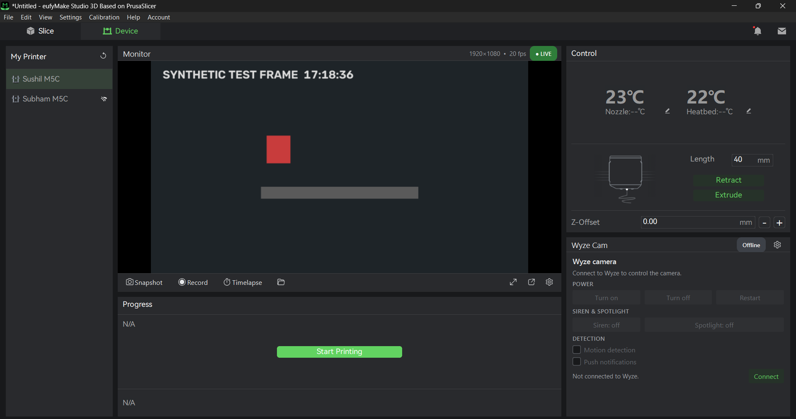

# Wyze Print Monitor

A desktop companion for 3D printing: live view of a **Wyze Cam V3** (mounted
on the printer) plus a real camera control panel — power, restart, siren,
spotlight, motion detection, and notifications — alongside snapshot, clip
recording, and print timelapses.

Built because slicer monitor tabs (e.g. eufyMake Studio's Device → Monitor)
only show a printer's *built-in* camera and offer no way to plug in an
external camera. On Windows the app plugs itself **into eufyMake Studio's
Device tab**; anywhere else it runs as its own window next to the slicer.

  

## Inside eufyMake Studio (Windows)



With eufyMake Studio (or AnkerMake Studio) open, the app embeds two panels
straight into Studio's **Device** tab:

- **Monitor** — Studio's "does not support real-time video" box becomes the
  live Wyze feed, with LIVE / resolution / recording / timelapse chips and a
  toolbar: snapshot, record, timelapse, open folders, fullscreen, full
  window, settings.
- **Wyze Cam** — Studio's empty "Others" card becomes the camera controls:
  connect, power on/off, restart, siren, spotlight, motion detection, push
  notifications and device info.

Studio's own Control (temperatures, extrude/retract, Z-offset), Progress /
Start Printing and printer list are untouched. The panels are real child
windows of Studio, so they move, resize and minimize with it and disappear
on the Slice tab. They only appear while the printer with the camera is
selected in **My Printer** — set which row that is under Settings →
*Printer with camera* (default: the first printer; "Any printer" to always
show). Turn embedding off with *Show inside eufyMake Studio's Device tab*.

While docked, the full window is hidden; open it from the toolbar's window
button or the tray icon (closing it just hides it again — use File → Exit or
the tray's Exit to quit). Studio's UI must be in English (panels are found
by their "Monitor" / "Others" / "My Printer" labels).

## Features

**Monitor (left)**
- Live RTSP view from the Wyze Cam V3, with auto-reconnect
- Always-on-top window (toggleable) so it floats over the slicer
- One-click **snapshot** (PNG), **clip recording** (MP4)
- **Print timelapse**: captures a frame every N seconds, compiles to MP4 when stopped
- Live fps / resolution readout and connection status pill
- Launch at startup (Windows / Linux), toggleable in Settings

**Control (right)**
- Wyze cloud login (email + password + API key), with 2FA prompt when required
- Camera picker (all cameras on the account)
- Camera power on/off, **restart**
- **Siren** on/off, **spotlight** on/off
- Motion detection on/off, push notifications on/off
- Device info: model, online status, firmware, LAN IP

## Prerequisites

1. **Wyze Cam v3 with RTSP enabled** — in the Wyze app: camera → Settings →
   Advanced Settings → RTSP → toggle on, set a username/password, then
   *Generate URL*. Use that `rtsp://…` URL in this app's settings.
   (The camera keeps working in the Wyze app at the same time.)
2. **Wyze API key ID + API key** — create them in the Wyze developer portal
   and paste them into File → Settings. They authenticate this app's camera
   controls.
3. **Python 3.10+** on Windows/macOS/Linux.

## Install & run

```bash
pip install -e .   # installs the app and the `wyze-print-monitor` command

wyze-print-monitor
```

First run: **File → Settings…** → paste the RTSP URL, Wyze email, password,
API key ID and API key → *Connect & list cameras* → pick your printer camera.
Credentials are stored in your OS keyring (Windows Credential Manager /
macOS Keychain / Linux Secret Service) — never in the settings file.

## Notes

- The V3's RTSP firmware has a few seconds of lag; that's the camera, not the app.
- The decode buffer is kept tiny on purpose so the view stays close to live.
- Timelapse frames are saved as JPEGs next to the final MP4; delete the
  `*_frames` folder after compiling if you don't need the stills.

## Roadmap

- AnkerMake M5C printer telemetry (nozzle/bed temps, print progress) next to the video
- More camera properties (night-vision mode, flip/rotate, status LED)
- Packaged Windows `.exe` via PyInstaller

## License

MIT — see [LICENSE](LICENSE).
